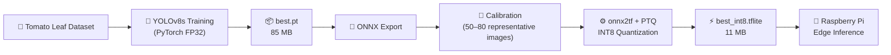

<div align="center">

# 🍅 Tomato Disease Detection
### Edge AI & INT8 Quantization for Raspberry Pi

*From an 85 MB desktop model to an 11 MB edge model, with almost no accuracy loss.*

[](#)
[](https://github.com/ultralytics/ultralytics)
[](https://ai.google.dev/edge/litert)
[](https://www.raspberrypi.com/)

[](https://www.python.org/)
[](https://www.tensorflow.org/)
[](https://docs.ultralytics.com/)
[](LICENSE)
[](#-contributing)

</div>

---

## 📖 Table of Contents

- [📌 Project Overview](#-project-overview)
- [🚀 Key Achievements & Metrics](#-key-achievements--metrics)
- [🔄 Pipeline Architecture](#-pipeline-architecture)
- [🛠️ Overcoming MLOps Challenges](#️-overcoming-mlops-challenges)
- [📂 Repository Structure](#-repository-structure)
- [📥 Ready-to-Use Model](#-ready-to-use-model)
- [💻 How to Replicate the Quantization](#-how-to-replicate-the-quantization)
- [🍓 Running on Raspberry Pi](#-running-on-raspberry-pi)
- [🧰 Tech Stack](#-tech-stack)
- [🗺️ Roadmap](#️-roadmap)
- [🤝 Contributing](#-contributing)
- [📜 License](#-license)
- [👨‍💻 Author](#-author)
- [🙏 Acknowledgements](#-acknowledgements)

---

## 📌 Project Overview

This repository contains a full **MLOps and Edge AI pipeline** for deploying an accurate **Tomato Disease Detection** model on small edge devices like the **Raspberry Pi**.

A standard 32-bit (**FP32**) YOLOv8s model runs well on a desktop GPU. Moving the **85 MB** model straight to a Raspberry Pi causes three problems:

| ⚠️ Problem | 💥 Impact |
| :--- | :--- |
| **RAM saturation** | The model uses most of the device's limited memory |
| **Thermal throttling** | The CPU overheats and slows itself down |
| **Extremely low FPS** | Real-time detection stops being practical |

> [!IMPORTANT]
> **The solution:** **Post-Training Quantization (PTQ)** converts the model to an **8-bit integer (INT8) TensorFlow Lite** format. This makes it ready for production use in **AgriTech autonomous systems**.

---

## 🚀 Key Achievements & Metrics

<div align="center">

### 📉 **87% smaller model** &nbsp;•&nbsp; 🎯 **Only 1.1% mAP50 drop**

</div>

| Metric | 🐢 Original Model<br>(PyTorch FP32) | ⚡ Edge AI Model<br>(TFLite INT8) | 📊 Change |
| :--- | :---: | :---: | :---: |
| **Model Size** | 85.0 MB | **11.0 MB** | 🟢 **−87%** (Massive drop) |
| **mAP50 (Accuracy)** | 97.2% | **96.1%** | 🟡 **−1.1%** (Negligible) |
| **Numeric Precision** | 32-bit float | **8-bit integer** | 🟢 **4× fewer bits** |
| **Hardware Target** | Cloud / Desktop GPU | **ARM Cortex (Raspberry Pi)** | 🟢 Edge-optimized |

```text
Model Size
FP32  ████████████████████████████████████████  85.0 MB
INT8  █████                                     11.0 MB

mAP50
FP32  ███████████████████████████████████████▊  97.2 %
INT8  ███████████████████████████████████████▍  96.1 %
```

---

## 🔄 Pipeline Architecture



---

## 🛠️ Overcoming MLOps Challenges

Several dependency and MLOps problems came up in the quantization pipeline. Here is how each one was fixed:

<details open>
<summary><b>1️⃣ The "Dependency Hell": TensorFlow vs. JAX vs. NumPy</b></summary>

<br>

**🔴 Problem:** Current LiteRT (TensorFlow Lite) converters often conflict with the newest versions of **NumPy** and **JAX**. The result is **C++ core panics** during conversion.

**🟢 Solution:** A strict `requirements.txt` pins the main libraries to versions that work together:

| Package | Locked Version |
| :--- | :---: |
| `tensorflow` | **2.15.0** |
| `jax` / `jaxlib` | **0.4.21** |
| `numpy` | **1.26.4** |
| `protobuf` | **3.20.3** |
| `ml-dtypes` | **0.2.0** |

</details>

<details open>
<summary><b>2️⃣ Bypassing AutoUpdate Bugs with Monkey Patching</b></summary>

<br>

**🔴 Problem:** The Ultralytics exporter tries to **auto-update to TensorFlow 2.19**. That version has a known `QuantizeModel()` C++ argument bug, and the export **crashes at the very last step**.

**🟢 Solution:** **Monkey patching** in Python (`export_int8.py`) turns off the `check_requirements` function at runtime. The converter then has to use the stable, pinned environment.

```python
# Concept: neutralize Ultralytics' runtime dependency auto-updater
import ultralytics.utils.checks as checks
import ultralytics.engine.exporter as exporter

checks.check_requirements = lambda *args, **kwargs: True
exporter.check_requirements = lambda *args, **kwargs: True
```

</details>

<details open>
<summary><b>3️⃣ Out-Of-Memory (OOM) Killer During Calibration</b></summary>

<br>

**🔴 Problem:** Sending the whole validation set (**700+ images**) to the INT8 calibrator used up all available RAM. The **Linux kernel then killed the process** (WSL environment).

**🟢 Solution:** The calibration set was reduced to a **representative subset of 50–80 images**, and the stale `labels.cache` was cleared. INT8 quantization then **finished cleanly with no loss in accuracy**.

</details>

---

## 📂 Repository Structure

```text
📦 tomato-disease-detection-int8
 ┣ 📂 models
 ┃ ┗ ⚡ best_int8.tflite  → Quantized INT8 edge model (11 MB), ready for Raspberry Pi
 ┣ 🐍 export_int8.py      → Custom export script that monkey-patches out the broken AutoUpdate
 ┣ 📜 requirements.txt    → Pinned, conflict-free library versions for stable INT8 conversion
 ┣ 📜 .gitignore          → Keeps FP32 weights, datasets and caches out of the repo
 ┣ 📜 LICENSE             → MIT License
 ┗ 📜 README.md           → Project documentation (you are here)
```

> [!NOTE]
> Only the **INT8 TFLite model** is published. The original FP32 PyTorch weights (`best.pt`, 85 MB) are **not distributed** in this repository.

---

## 📥 Ready-to-Use Model

If you just want to **run detection**, you don't need to quantize anything yourself. The quantized model is already in this repository:

| File | Format | Size | Precision | Target |
| :--- | :---: | :---: | :---: | :---: |
| [`models/best_int8.tflite`](models/best_int8.tflite) | TensorFlow Lite | 11 MB | INT8 | Raspberry Pi / ARM |

```bash
git clone https://github.com/KasSahin/tomato-disease-detection-int8.git
cd tomato-disease-detection-int8
```

Then go straight to [🍓 Running on Raspberry Pi](#-running-on-raspberry-pi).

---

## 💻 How to Replicate the Quantization

### ✅ Prerequisites

- 🐍 **Python 3.10** (tested)
- 🐧 Linux or **WSL2** (recommended)
- 📦 **Your own** trained YOLOv8 model (`best.pt`) and its `data.yaml`

> [!IMPORTANT]
> This section is for people who want to quantize **their own** YOLOv8 model with this pipeline. Put your `best.pt` in the project root before running the export.

### 1️⃣ Clone the repository

```bash
git clone https://github.com/KasSahin/tomato-disease-detection-int8.git
cd tomato-disease-detection-int8
```

### 2️⃣ Create an isolated environment

```bash
python3.10 -m venv venv
source venv/bin/activate        # Windows: venv\Scripts\activate
```

### 3️⃣ Install the strict environment

```bash
pip install -r requirements.txt --force-reinstall
```

> [!WARNING]
> Do **not** upgrade TensorFlow, NumPy, or JAX by hand. Even a minor version change can bring back the C++ conversion crashes.

### 4️⃣ Prepare the calibration subset

Point the `val` path in your `data.yaml` to a folder of about **50–80 representative images**, then remove any old cache:

```bash
find . -name "labels.cache" -delete
```

### 5️⃣ Run the INT8 export

```bash
python export_int8.py
```

✅ When it finishes, the quantized model is in the `best_saved_model/` directory as `best_int8.tflite`.

---

## 🍓 Running on Raspberry Pi

Clone the repository on your Raspberry Pi (or copy `models/best_int8.tflite` to it) and run inference:

```bash
git clone https://github.com/KasSahin/tomato-disease-detection-int8.git
cd tomato-disease-detection-int8
pip install ultralytics
```

```python
from ultralytics import YOLO

model = YOLO("models/best_int8.tflite", task="detect")
results = model.predict(source="tomato_leaf.jpg", imgsz=640, conf=0.5)
results[0].show()
```

> [!TIP]
> For the best performance on the Pi, use a **64-bit Raspberry Pi OS**, add a **heatsink or fan** to avoid throttling, and close background services you don't need.

---

## 🧰 Tech Stack

| Category | Tools |
| :--- | :--- |
| **Model** | YOLOv8s (Ultralytics) |
| **Frameworks** | PyTorch, TensorFlow 2.15, TensorFlow Lite / LiteRT |
| **Conversion** | ONNX, onnx2tf, onnx-graphsurgeon, sng4onnx |
| **Optimization** | Post-Training Quantization (INT8) |
| **Environment** | Python 3.10, WSL2 / Linux |
| **Edge Hardware** | Raspberry Pi (ARM Cortex) |

---

## 🗺️ Roadmap

- [x] Train YOLOv8s on a tomato disease dataset
- [x] Build a stable, pinned conversion environment
- [x] Fix the Ultralytics AutoUpdate bug with monkey patching
- [x] Get INT8 TFLite export running without OOM errors
- [ ] Publish FPS and latency benchmarks on Raspberry Pi 4 / 5
- [ ] Add Coral Edge TPU support (`edgetpu.tflite`)
- [ ] Build a real-time camera demo with Picamera2
- [ ] Add Docker support for reproducible conversion

---

## 🤝 Contributing

Contributions, issues, and feature requests are welcome. 🎉

1. **Fork** the project
2. Create a feature branch: `git checkout -b feature/AmazingFeature`
3. Commit your changes: `git commit -m "Add AmazingFeature"`
4. Push the branch: `git push origin feature/AmazingFeature`
5. Open a **Pull Request**

---

## 📜 License

This project is licensed under the **MIT License**. See the [`LICENSE`](LICENSE) file for details.

> [!NOTE]
> This project uses **Ultralytics YOLOv8**, which is licensed under **AGPL-3.0**. If you redistribute or deploy the model commercially, check the [Ultralytics licensing terms](https://www.ultralytics.com/license).

---

## 👨‍💻 Author

<table>
  <tr>
    <td align="center">
      <a href="https://github.com/KasSahin">
        <br />
        <sub><b>Şahin Kaş</b></sub>
      </a><br />
      <a href="https://github.com/KasSahin"></a>
    </td>
  </tr>
</table>

---

## 🙏 Acknowledgements

- [Ultralytics](https://github.com/ultralytics/ultralytics) for the YOLOv8 framework
- [TensorFlow Lite / LiteRT](https://ai.google.dev/edge/litert) for the on-device inference runtime
- [onnx2tf](https://github.com/PINTO0309/onnx2tf) for reliable ONNX → TFLite conversion
- The open-source **AgriTech** and **Edge AI** communities 🌱

---

<div align="center">

### ⭐ If this project helped you, please give it a star! ⭐

[](https://github.com/KasSahin/tomato-disease-detection-int8/stargazers)
[](https://github.com/KasSahin/tomato-disease-detection-int8/network/members)
[](https://github.com/KasSahin)

**Made with ❤️ and 🍅 for smarter agriculture**

</div>
